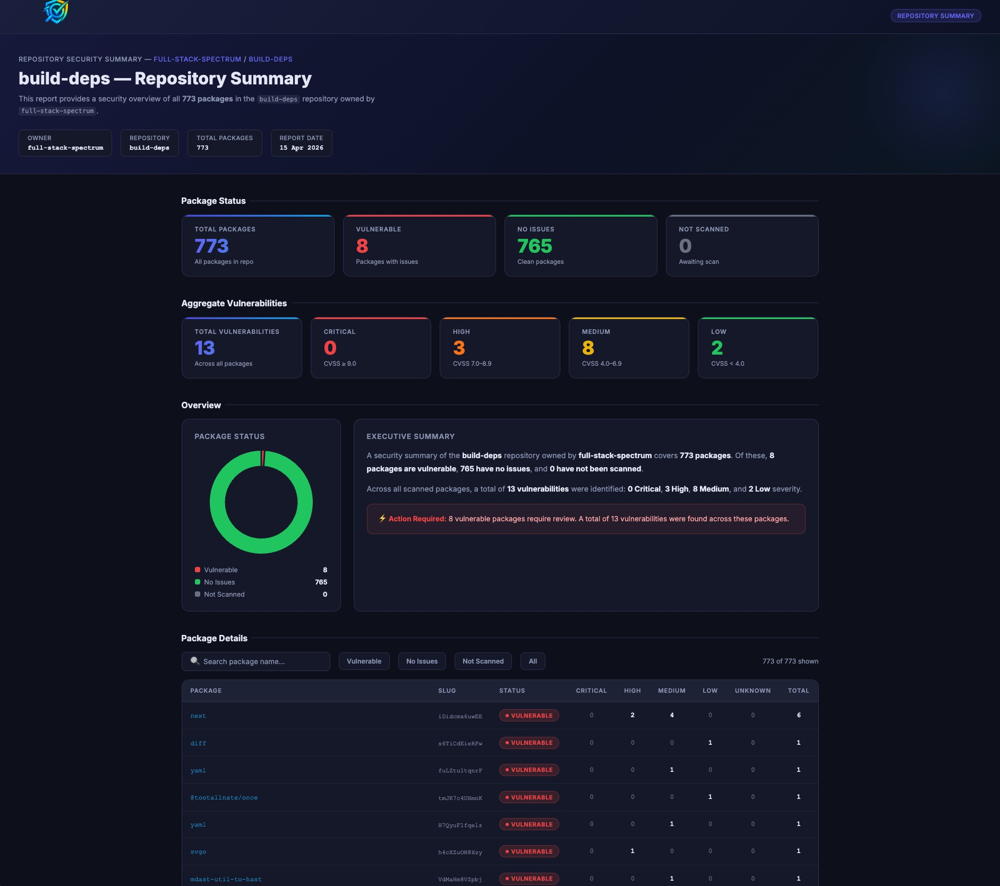

# Assay

A CLI tool that summarises [OSV](https://osv.dev) vulnerability data from [Cloudsmith](https://cloudsmith.com) across a whole **workspace** or a single **repository**. Output is a rich terminal report or machine-readable JSON.

Combine it with [Vulnly](https://pypi.org/project/vulnly/) to generate beautified HTML reports.

## Features

- Workspace-wide or per-repository summaries from Cloudsmith's OSV vulnerability endpoints
- One paginated request stream; no per-package scan lookups
- Severity breakdown per package: Malware, Critical, High, Medium, Low, Unknown
- Per-repository rollup for workspace reports
- Rich terminal report: stat tiles, severity distribution bar, ranked package table with inline severity bars, and a layout that adapts to narrow terminals
- Server-side filters by threat level, advisory ID (CVE/GHSA, including aliases) and malware
- Authenticates with an API key **or** through the Cloudsmith CLI (API key, profiles, SSO or OIDC)
- Clean JSON output mode (all status messages go to stderr)

## Requirements

- Python 3.10+
- Either a [Cloudsmith API key](https://docs.cloudsmith.com/accounts-and-teams/api-key) or the [Cloudsmith CLI](https://docs.cloudsmith.com/developer-tools/cli) (a version with `credential-helper`), signed in

## Installation

Run it directly with [uv](https://docs.astral.sh/uv/). Dependencies are declared inline in the script:

```bash
uv run assay.py --workspace <workspace>
```

Or install it as an `assay` command:

```bash
uv tool install .
assay --workspace <workspace>
```

## Authentication

Assay resolves credentials in this order (`--auth auto`, the default):

1. **`CLOUDSMITH_API_KEY`** environment variable
2. **Cloudsmith CLI**: Assay calls `cloudsmith credential-helper generic`, which uses the CLI's credential chain: `credentials.ini` (including profiles), SSO sessions from `cloudsmith auth`, and OIDC.

```bash
# API key
export CLOUDSMITH_API_KEY="your-api-key-here"

# ...or sign in with the CLI (SAML SSO) and let Assay pick it up
cloudsmith auth -o <workspace>

# ...or use a specific CLI profile from credentials.ini
assay --workspace <workspace> --profile staging
```

Use `--auth env` or `--auth cli` to force one source. `--profile` implies `--auth cli`.

## Usage

### Workspace summary

```bash
assay --workspace <workspace>
```

Shows per-repository stats and the 5 most impacted packages across the workspace. Use `--limit N` for a different number, or `--limit 0` to list every package.

### Repository summary

```bash
assay --workspace <workspace> --repo <repo>
```

If your credentials can't use the repository-level endpoint (HTTP 403), Assay falls back to the workspace endpoint filtered to that repository and tells you it did.

### Top N, sorting and filters

```bash
# 20 worst packages in the workspace instead of the default 5
assay -w <workspace> --limit 20

# Most-downloaded vulnerable packages first
assay -w <workspace> --sort downloads

# Which packages are affected by a specific advisory?
assay -w <workspace> --vulnerability-id CVE-2024-3094

# Only packages with critical findings in one repo
assay -w <workspace> -r <repo> --threat-level critical

# Malware only
assay -w <workspace> --malware-only
```

### JSON output

```bash
assay -w <workspace> -r <repo> --output json | jq .
```

JSON goes to stdout and all progress/status messages go to stderr, so piping is safe.

## Vulnly

Pipe the JSON output into [Vulnly](https://pypi.org/project/vulnly/) with the `-` flag (read from stdin) to produce an HTML report:

```bash
assay -w <workspace> -r <repo> --output json | vulnly -
```



## Arguments

| Argument | Default | Description |
| --- | --- | --- |
| `-w`, `--workspace` | *required* | Workspace slug. `--owner` / `-o` are accepted as aliases |
| `-r`, `--repo` | | Repository slug. Omit for a workspace-wide summary |
| `-F`, `--output` | `table` | `table` or `json` |
| `--sort` | `severity` | `severity`, `total`, `name`, `downloads` or `uploaded` |
| `-n`, `--limit` | `5` for workspace tables, otherwise all | Only show the top N packages (`0` = all) |
| `--threat-level` | | `malware`, `critical`, `high`, `medium`, `low` or `unknown` |
| `--vulnerability-id` | | Advisory ID, e.g. `CVE-2024-1234` or `GHSA-xxxx`. Exact and case-sensitive; aliases also match |
| `--malware-only` / `--exclude-malware` | | Include only, or exclude, malware advisories |
| `--auth` | `auto` | `auto`, `env` or `cli` |
| `-P`, `--profile` | | Cloudsmith CLI profile (implies `--auth cli`) |
| `--version` | | Print the version |

`severity` sorting ranks packages by malware count, then critical, high, medium, low and unknown.

Set `CLOUDSMITH_API_HOST` to target a different API host.

## Example output

### Table

```
╭──────────────────────────────────────────────────────────────────────────────────────────────────╮
│  Assay  OSV vulnerability summary                                                                │
│  Workspace my-org   Repository my-repo                                                           │
│  Generated 2026-10-25T16:21:19+00:00  ·  Auth via Cloudsmith CLI                                 │
╰──────────────────────────────────────────────────────────────────────────────────────────────────╯
╭────────────╮ ╭────────────╮ ╭───────────╮ ╭───────────╮ ╭───────────╮ ╭───────────╮ ╭────────────╮
│     22     │ │     0      │ │    240    │ │   2,089   │ │   2,795   │ │    646    │ │    340     │
│  Packages  │ │  Malware   │ │ Critical  │ │   High    │ │  Medium   │ │    Low    │ │  Unknown   │
│  affected  │ │   0 pkgs   │ │  12 pkgs  │ │  20 pkgs  │ │  18 pkgs  │ │  16 pkgs  │ │  12 pkgs   │
╰────────────╯ ╰────────────╯ ╰───────────╯ ╰───────────╯ ╰───────────╯ ╰───────────╯ ╰────────────╯
██████████████████████████████████████████████████████████████████████████████████████████████████
6,110 findings   ■ Critical 4%   ■ High 34%   ■ Medium 46%   ■ Low 11%   ■ Unknown 6%

Packages

  #   Package                                 Version     Crit    High     Med   Low   Unk   Total
 ──────────────────────────────────────────────────────────────────────────────────────────────────
  1   tensorflow/tensorflow                   2756868d…    115   1,128   1,674   454     2   3,373
  2   pytorch/pytorch                         ac63aaae…     40     593     715    55    91   1,494
  3   tensorflow/tensorflow                   0200f5f5…     13      96      95    42     8     254
  4   tensorflow/tensorflow                   bc3d45b2…     12      87      83    42     7     231
  5   velero/velero                           1c9d2c38…     12      25      21     4    28      90

Showing top 5 of 22 packages · use --limit 0 to show all
────────────────────────────────────────────────────────────────────────────────────────────────────
22 vulnerable packages · 6,110 OSV findings · fetched in 0.8s
```

Workspace reports show a **Repositories** table followed by the **Top 5 most impacted packages** instead of the full package list. Terminals 130+ columns wide get Format, Repository and Downloads columns, and 150+ columns add per-row severity bars, scaled to the largest row. The Malware column appears only when there is malware.

### JSON

```json
{
  "data": {
    "owner": "my-org",
    "workspace": "my-org",
    "repository": "my-repo",
    "scope": "repository",
    "generated_at": "2026-10-25T16:21:19+00:00",
    "filters": {},
    "summary": {
      "packages": 22,
      "repositories": 1,
      "vulnerabilities": {
        "malware": 0, "critical": 240, "high": 2089, "medium": 2795,
        "low": 646, "unknown": 340, "total": 6110
      },
      "packages_affected_by": {
        "malware": 0, "critical": 12, "high": 20, "medium": 18,
        "low": 16, "unknown": 12
      }
    },
    "packages": [
      {
        "package": "tensorflow/tensorflow",
        "version": "2756868df3c951c7...",
        "slug_perm": "QzFNvvmi9MUo",
        "repository": "my-repo",
        "format": "docker",
        "downloads": 2,
        "uploaded_at": "2026-10-19T16:15:59.716839Z",
        "sync_status": "7",
        "status": "vulnerable",
        "highest_severity": "critical",
        "num_vulnerabilities": 3373,
        "vulnerabilities": {
          "malware": 0, "critical": 115, "high": 1128,
          "medium": 1674, "low": 454, "unknown": 2
        }
      }
    ]
  }
}
```

Workspace reports also include a `repositories` array with the same per-severity rollup. `owner`, `repository`, and each package's `package`, `version`, `slug_perm`, `status`, `num_vulnerabilities` and `vulnerabilities` keep the field names used by earlier versions.

## API endpoints used

| Endpoint | Purpose |
| --- | --- |
| `GET /v2/workspaces/{workspace}/vulnerabilities/packages/` | OSV vulnerability summary for every package in a workspace |
| `GET /v2/workspaces/{workspace}/repos/{repo}/vulnerabilities/packages/` | OSV vulnerability summary for every package in a repository |

See the Cloudsmith docs for the [workspace](https://docs.cloudsmith.com/api/workspaces/vulnerabilities/packages/list) and [repository](https://docs.cloudsmith.com/api/workspaces/vulnerabilities/repo/packages/list) endpoints.

## License

Copyright 2026 Cloudsmith Ltd
